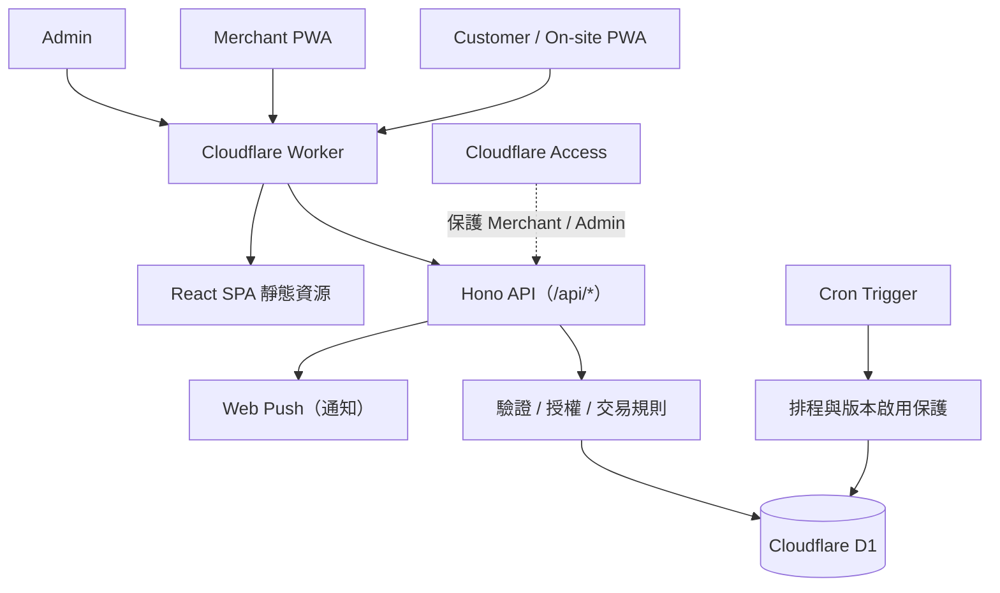

<div align="center">
  

  # 吃炸的｜雲端點餐與店家營運系統

  **Cloud Ordering & Store Operations · React + TypeScript + Cloudflare Workers + D1**

  為台灣實體炸物店設計的單店點餐系統，整合顧客線上點餐、現場 QR 點餐、店家接單與管理後台。
  以**真實訂單的一致性、權限邊界和操作可靠性**為工程重點，而不只是製作菜單頁面。

  [顧客線上點餐](https://chizhade.com/) · [現場掃碼入口](https://chizhade.com/onsite) · [商家工作台（需授權）](https://chizhade.com/merchant) · [商品管理（需授權）](https://chizhade.com/admin)
</div>

> **Demo 提醒**：公開網址連接真實店家環境，請勿為了測試而送出訂單。商家端與 Admin 受 Cloudflare Access 保護；沒有登入權限是預期的安全設計。本倉庫公開的是程式碼，並非測試帳號或金鑰。

## 01 · 產品情境與設計目標

尖峰時段電話與現場點餐容易產生漏單、排隊、取餐時間混亂，以及已售完商品仍被點選的問題。這個專案將「顧客下單 → 店家接單／製作 → 顧客查看狀態」串成可操作的流程。

- **一間真實店家，三種操作角色**：顧客、Merchant、Admin；不為了展示而虛構多租戶需求。
- **手機優先、低硬體門檻**：網頁＋PWA，店家不必添購專用 POS 設備。
- **後端決定價格與訂單狀態**：前端僅提供互動與預覽，Cloudflare D1 保存權威資料。
- **失敗情境也要正確**：重複送單、併發接單、資料過期、短缺調整、網路中斷都納入設計與測試。

## 02 · 功能展示

| 角色 | 主要功能 | 入口 |
| --- | --- | --- |
| **Customer** | 分類菜單、份量與辣度選項、購物車、預計取餐時間、訂單狀態與允許期限內取消 | [線上點餐](https://chizhade.com/) |
| **On-site QR** | 掃碼進入現場下單流程；由後端識別來源，現場單不需填姓名電話 | [現場點餐](https://chizhade.com/onsite) |
| **Merchant** | 待接單／製作中／售罄、接單與完成、缺貨處理、暫停接單、通知與連線狀態 | [工作台](https://chizhade.com/merchant)（Access） |
| **Admin** | 管理分類、商品、價格、圖片及展示設定；獨立角色授權 | [管理後台](https://chizhade.com/admin)（Access） |

實際店家可能暫停接單，這不代表網站故障。公開頁面的即時營業狀態與售價，以正式系統為準。

## 03 · 系統架構



| 層級 | 技術 |
| --- | --- |
| Frontend | React 19、TypeScript、Vite、Responsive Web UI |
| Backend | Cloudflare Workers、Hono |
| Database | Cloudflare D1 / SQLite、SQL Migrations |
| Auth & Security | Cloudflare Access JWT、角色分離、Origin／Fetch Metadata Guard |
| Reliability | D1 原子交易、CAS、Idempotency、Audit Log |
| Notifications | Service Worker、Web Push、5 秒 Merchant Polling fallback |
| Test & Tooling | Vitest、Testing Library、TypeScript、ESLint、Wrangler |

## 04 · 工程重點（面試可深入討論）

### A. 避免重複訂單與錯價

**問題**：顧客連點送出、網路逾時重試，或確認價格後店家修改菜單。

**處理**：使用 Idempotency Key 與請求指紋識別重試；建單時由 D1 重新計價，對照 Quote Fingerprint，將訂單與品項／Modifier Snapshot、通知意圖以原子批次寫入。錯誤或競態不留下半張訂單。

**查看程式**：[Order Creation](src/worker/order-creation.ts) · [Concurrency Tests](test/order-concurrency.test.ts) · [Atomicity Tests](test/order-atomicity.test.ts)

### B. 多裝置接單與店家狀態一致性

**問題**：兩支手機同時接單／完成，或店家暫停接單的同時仍有顧客送出。

**處理**：訂單狀態使用條件式更新；商家開關使用 `state_version`、CAS、操作 ID 與 Audit；前端 Mutation 失敗不假裝成功，而是重新抓取權威狀態。

**查看程式**：[Merchant Orders](src/worker/merchant-orders.ts) · [Store Operations](src/worker/store-operations.ts)

### C. 權限邊界與安全防護

Merchant 與 Admin 具有不同 Cloudflare Access Audience。受保護 API 會驗證 JWT，Mutation 另外檢查 Origin／Fetch Metadata；公開建單與取消也有自己的 Origin Guard、輸入驗證與限流。前端隱藏按鈕不等於取得權限。

**查看程式**：[Authentication](src/worker/security.ts) · [Public Origin Guard](src/worker/public-origin.ts) · [Security Tests](test/public-origin-guard.test.ts)

### D. 可控的每日自動營業

23:15 後使用柔性收店規則；每日 17:30 恢復只針對明確的正常收店，不能覆蓋人工暫停或漏單保護。Scheduler Activation 預設關閉，並綁定核准的 Worker Version；版本不符或狀態不可信時 Fail Closed。

**查看程式**：[Store Schedule](src/worker/store-schedule.ts) · [Scheduler Activation](src/worker/scheduler-activation.ts) · [Activation Tests](test/scheduler-activation.test.ts)

### E. 通知失敗不等於訂單失敗

建立訂單與儲存通知意圖屬於資料交易；Web Push 屬於 Commit 後的附帶行為。推播失敗不能回滾已成立的訂單，Merchant 仍透過輪詢取得權威訂單列表。

**查看設計**：[Product Blueprint](docs/PRODUCT_BLUEPRINT.md)

## 05 · 技術取捨

- **單 Worker 架構**：一間店用 React SPA + Hono API + D1，減少分離部署、環境與硬體維護成本。
- **PWA 而非原生 App**：顧客掃碼即可使用，Merchant 可以加入手機主畫面；背景通知與音量能力仍受作業系統限制。
- **Polling + Push**：推播提供提醒，輪詢與 D1 才是訂單狀態依據。
- **不將排程等同直接寫入權限**：Cron 仍需經過 Store State、Version、CAS 與 Audit 的保護。
- **不誇大產品範圍**：這是單店點餐／營運系統，不宣稱已具備金流、POS 硬體整合或 SaaS 多租戶能力。

## 06 · 本機啟動與驗證

需要 Node.js 與 npm。使用本機 D1，**不連線 Production D1**：

```bash
npm install
npm run db:migrate:local
npm run db:seed:local
npm run dev
```

啟動後開啟 `http://localhost:5173`。本機 Seed 僅供開發與測試，**商品售價不代表目前正式環境價格**。

```bash
npm run test:worker
npm run test:dom
npm run check
npm run verify
```

`npm run verify` 會進行本機驗證，不是 Production 部署。Windows PowerShell 可使用 `npm.cmd` 代替 `npm`。

## 07 · 專案文件與開發流程

- [產品規則與交易邊界](docs/PRODUCT_BLUEPRINT.md)
- [正式發布／回滾流程](docs/DEPLOYMENT_RUNBOOK.md)
- [Scheduler 版本啟用與安全](docs/SCHEDULER_ACTIVATION_RELEASE.md)
- [主分支與 PR 開發規範](docs/MAIN_DEVELOPMENT_POLICY.md)
- [面試展示截圖與安全注意事項](docs/PORTFOLIO_SCREENSHOTS.md)

本專案使用 **AI-assisted development**：以 AI Coding Agent 協助實作、測試與文件整理，透過 Git Branch／PR、明確需求、回歸測試與 Release Gate 管理結果。面試時應以實際理解與能解釋的程式／決策為準，不將 AI 產出的所有內容視為未經驗證的個人能力。

---

**English summary:** A single-store ordering and operations system for a real Taiwanese fried-food shop, built with React, TypeScript, Hono, Cloudflare Workers and D1. Engineering focus: authoritative pricing, atomic order creation, idempotency, concurrency control, role-based access boundaries, PWA notifications and fail-closed scheduled operations.
