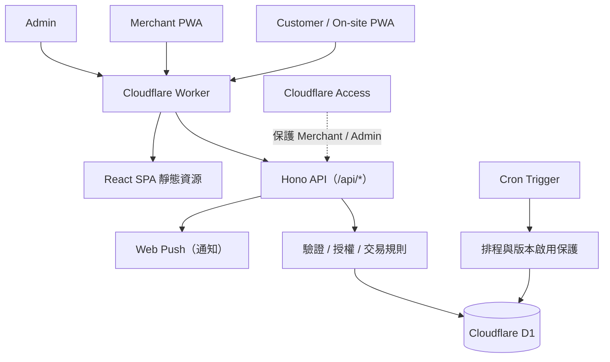

<div align="center">
  

  # 吃炸的｜實體餐飲店雲端點餐與營運系統

  **Client-oriented Production System · React + TypeScript + Cloudflare Workers + D1**

  以台灣實際營業的炸物店需求為背景，設計**可供店家操作的單店點餐與營運系統**：顧客線上點餐、現場 QR 點餐、商家接單與 Admin 管理。
  重點是**需求落地、交易資料正確性、權限、安全發布與營運交付**，而不只是完成一個展示網站。

  [顧客線上點餐](https://chizhade.com/) · [現場掃碼入口](https://chizhade.com/onsite) · [商家工作台（需授權）](https://chizhade.com/merchant) · [商品管理（需授權）](https://chizhade.com/admin)
</div>

> **公開展示注意**：此網址連接真實店家，請勿為 Demo 送出正式訂單。Merchant / Admin 需要 Cloudflare Access 授權。此專案以真實店家業務需求為背景，**不宣稱有付費委託合約、客戶正式簽收、特定營收或 SLA**；對外交付狀態以[品質與驗收證據](docs/CLIENT_DELIVERY_ASSURANCE.md)為準。

## 01 · 店家需求與交付目標

**業務問題**：尖峰時段電話／現場點單容易漏單、取餐時間難以協調，已售罄品項仍可能被誤點。店家需要簡單、低硬體成本、可直接在手機上操作的接單流程。

**交付目標**：整合「顧客選餐 → 送出訂單 → 商家接單／製作 → 顧客查看狀態／取餐」流程，並讓營業狀態、缺貨和訂單截止時間在顧客與商家間保持一致。

- **真實商家情境，三種操作角色**：顧客、Merchant、Admin；不為了展示而虛構多租戶需求。
- **手機優先、低硬體門檻**：網頁＋PWA，店家不必添購專用 POS 設備。
- **後端決定價格與訂單狀態**：前端僅提供互動與預覽，Cloudflare D1 保存權威資料。
- **失敗情境也要正確**：重複送單、併發接單、資料過期、短缺調整、網路中斷都納入設計與測試。

## 02 · 功能展示

| 角色 | 主要功能 | 入口 |
| --- | --- | --- |
| **Customer** | 分類菜單、份量與辣度選項、購物車、預計取餐時間、訂單狀態與允許期限內取消 | [線上點餐](https://chizhade.com/) |
| **On-site QR** | 掃碼進入現場下單流程；由後端識別來源，現場單不需填姓名電話 | [現場點餐](https://chizhade.com/onsite) |
| **Merchant** | 待接單／製作中／售罄、接單與完成、缺貨處理、暫停接單、通知與連線狀態 | [工作台](https://chizhade.com/merchant)（Access） |
| **Admin** | 管理分類、商品、價格、圖片及展示設定；獨立角色授權 | [管理後台](https://chizhade.com/admin)（Access） |

實際店家可能暫停接單，這不代表網站故障。公開頁面的即時營業狀態與售價，以正式系統為準。

## 03 · 交付品質與保障範圍

商用系統除了正常操作，更要說清楚**故障時怎麼辦、誰負責，以及哪些情境已被測試**。下表是目前的**工程證據摘要**，不等於店家已簽收或正式 SLA：

| 業務保障 | 已建立的工程機制 | 還需要的實際驗收 |
| --- | --- | --- |
| **不重複扣單、不錯價** | Idempotency、後端重新計價、D1 原子批次與 Snapshot | 真實操作／弱網路與菜單改價的情境驗證 |
| **兩台手機操作不互相覆蓋** | 訂單狀態條件更新、CAS、Store Audit | 商家雙機 UAT |
| **權限與個資保護** | Access JWT、角色隔離、Origin Guard、Opaque Order Token | 正式 Access 設定、新版本驗證、個資告知與保存政策 |
| **發版失敗能停止與回退** | Release Gate、版本驗證與 Rollback SOP | 演練及最新部署證據 |
| **店家持續收到新訂單** | Web Push + Merchant 5 秒輪詢、斷線提示 | 真實手機背景通知、現場提示音與營運告警 |
| **資料與營業安全** | D1 Time Travel 可用、Scheduler Version Gate | 隔離復原演練、自然排程 Audit、故障時人工接單 SOP |

**詳細交付檢查與缺口**：[客戶交付與品質保障矩陣](docs/CLIENT_DELIVERY_ASSURANCE.md)（包含需求驗收、資訊安全、監控、備份、保固／維護範本）。

> **透明範圍**：倉庫有實作與本機測試，不代表每一項 Production 配置、手機 UAT、壓測、故障監控與客戶書面驗收均已完成。這些項目分別列為待驗證，而不是用「可上線」三字一筆帶過。

## 04 · 系統架構



| 層級 | 技術 |
| --- | --- |
| Frontend | React 19、TypeScript、Vite、Responsive Web UI |
| Backend | Cloudflare Workers、Hono |
| Database | Cloudflare D1 / SQLite、SQL Migrations |
| Auth & Security | Cloudflare Access JWT、角色分離、Origin／Fetch Metadata Guard |
| Reliability | D1 原子交易、CAS、Idempotency、Audit Log |
| Notifications | Service Worker、Web Push、5 秒 Merchant Polling fallback |
| Test & Tooling | Vitest、Testing Library、TypeScript、ESLint、Wrangler |

## 05 · 工程重點（面試可深入討論）

### A. 避免重複訂單與錯價

**問題**：顧客連點送出、網路逾時重試，或確認價格後店家修改菜單。

**處理**：使用 Idempotency Key 與請求指紋識別重試；建單時由 D1 重新計價，對照 Quote Fingerprint，將訂單與品項／Modifier Snapshot、通知意圖以原子批次寫入。錯誤或競態不留下半張訂單。

**查看程式**：[Order Creation](src/worker/order-creation.ts) · [Concurrency Tests](test/order-concurrency.test.ts) · [Atomicity Tests](test/order-atomicity.test.ts)

### B. 多裝置接單與店家狀態一致性

**問題**：兩支手機同時接單／完成，或店家暫停接單的同時仍有顧客送出。

**處理**：訂單狀態使用條件式更新；商家開關使用 `state_version`、CAS、操作 ID 與 Audit；前端 Mutation 失敗不假裝成功，而是重新抓取權威狀態。

**查看程式**：[Merchant Orders](src/worker/merchant-orders.ts) · [Store Operations](src/worker/store-operations.ts)

### C. 權限邊界與安全防護

Merchant 與 Admin 具有不同 Cloudflare Access Audience。受保護 API 會驗證 JWT，Mutation 另外檢查 Origin／Fetch Metadata；公開建單與取消也有自己的 Origin Guard、輸入驗證與限流。前端隱藏按鈕不等於取得權限。

**查看程式**：[Authentication](src/worker/security.ts) · [Public Origin Guard](src/worker/public-origin.ts) · [Security Tests](test/public-origin-guard.test.ts)

### D. 可控的每日自動營業

23:15 後使用柔性收店規則；每日 17:30 恢復只針對明確的正常收店，不能覆蓋人工暫停或漏單保護。Scheduler Activation 預設關閉，並綁定核准的 Worker Version；版本不符或狀態不可信時 Fail Closed。

**查看程式**：[Store Schedule](src/worker/store-schedule.ts) · [Scheduler Activation](src/worker/scheduler-activation.ts) · [Activation Tests](test/scheduler-activation.test.ts)

### E. 通知失敗不等於訂單失敗

建立訂單與儲存通知意圖屬於資料交易；Web Push 屬於 Commit 後的附帶行為。推播失敗不能回滾已成立的訂單，Merchant 仍透過輪詢取得權威訂單列表。

**查看設計**：[Product Blueprint](docs/PRODUCT_BLUEPRINT.md)

## 06 · 技術取捨

- **單 Worker 架構**：一間店用 React SPA + Hono API + D1，減少分離部署、環境與硬體維護成本。
- **PWA 而非原生 App**：顧客掃碼即可使用，Merchant 可以加入手機主畫面；背景通知與音量能力仍受作業系統限制。
- **Polling + Push**：推播提供提醒，輪詢與 D1 才是訂單狀態依據。
- **不將排程等同直接寫入權限**：Cron 仍需經過 Store State、Version、CAS 與 Audit 的保護。
- **不誇大產品範圍**：這是單店點餐／營運系統，不宣稱已具備金流、POS 硬體整合或 SaaS 多租戶能力。

## 07 · 本機啟動與驗證

需要 Node.js 與 npm。使用本機 D1，**不連線 Production D1**：

```bash
npm install
npm run db:migrate:local
npm run db:seed:local
npm run dev
```

啟動後開啟 `http://localhost:5173`。本機 Seed 僅供開發與測試，**商品售價不代表目前正式環境價格**。

```bash
npm run test:worker
npm run test:dom
npm run check
npm run verify
```

`npm run verify` 會進行本機驗證，不是 Production 部署。Windows PowerShell 可使用 `npm.cmd` 代替 `npm`。

## 08 · 專案文件與開發流程

- [客戶交付、品質保障與待驗收清單](docs/CLIENT_DELIVERY_ASSURANCE.md)
- [產品規則與交易邊界](docs/PRODUCT_BLUEPRINT.md)
- [正式發布／回滾流程](docs/DEPLOYMENT_RUNBOOK.md)
- [Scheduler 版本啟用與安全](docs/SCHEDULER_ACTIVATION_RELEASE.md)
- [主分支與 PR 開發規範](docs/MAIN_DEVELOPMENT_POLICY.md)
- [面試展示截圖與安全注意事項](docs/PORTFOLIO_SCREENSHOTS.md)

**開發與交付方式**：以店家流程為需求來源，使用 Git Branch／PR、測試、驗收清單與 Release Gate 管理更動。本專案採 **AI-assisted development**，AI Coding Agent 協助實作與文件，工程品質需回到可檢查的程式碼、測試和實際商家驗收；沒有證據的客戶回饋與營運成效不會被包裝成成果。

---

**English summary:** A client-oriented, real-world ordering and store-operations system built around a Taiwanese fried-food shop's workflows. React, TypeScript, Hono, Cloudflare Workers and D1. Focus: correct business transactions, authoritative pricing, idempotency, concurrency control, access boundaries, failure recovery, and explicit delivery / acceptance criteria. Actual customer sign-off and service-level guarantees are not claimed.
