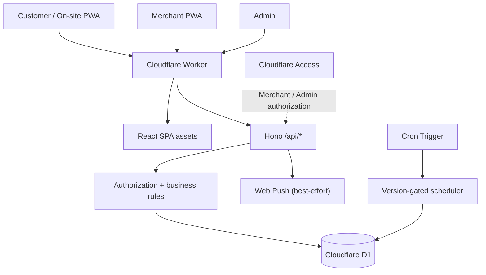

<div align="center">


# Chi Zha De (吃炸的)
### Restaurant Ordering & Store Operations System

**Real business workflow · React 19 · TypeScript · Hono · Cloudflare Workers · D1**

An ordering and operations platform designed around the day-to-day workflow of a real Taiwanese fried-food shop—from online ordering and on-site QR orders to kitchen operations and menu administration.

**Engineering focus:** transaction correctness, clear authorization boundaries, concurrency control, operational recovery, and evidence-based delivery.

[Production storefront](https://chizhade.com/) · [On-site ordering entry](https://chizhade.com/onsite) · [Merchant workspace (restricted)](https://chizhade.com/merchant) · [Admin console (restricted)](https://chizhade.com/admin)

**Language: English · [繁體中文](./README.zh-TW.md)**

</div>

> **Live business, not a public test sandbox.** The storefront is connected to a real shop. Please do **not** place fake or interview-test orders. Merchant and Admin are protected by Cloudflare Access. A separate, seeded interview demo is [planned, not yet publicly available](docs/DEMO_ENVIRONMENT_PLAN.md). Code implementation and local tests are not claims of signed client acceptance, commercial SLAs, or measured uptime.

## 1. Business problem and delivery goals

Phone calls and walk-in orders become difficult to coordinate during busy periods. Orders can be missed, pickup expectations can become unclear, and an item may sell out while customers are still browsing.

The solution is a **single-store, mobile-first ordering workflow**, with explicit business rules rather than a generic shopping-cart demo:

- **Customer:** browse categories, select portions and modifiers, check out, see pickup timing and order status.
- **On-site customer:** enter through a QR code, with server-authoritative order source and no mandatory contact fields.
- **Merchant:** accept, prepare, complete or reject orders; handle shortages, sold-out items, business availability and notifications.
- **Admin:** maintain items, categories, prices and display settings under a separate authorization policy.

The scope is intentionally limited to **one real shop**. This project does not claim to be a multi-tenant SaaS, payment gateway or full POS integration.

## 2. Product walkthrough

| Interface | Business capability | Access |
| --- | --- | --- |
| **Customer ordering** | Menu, portions/spice modifiers, cart, authoritative quote, pickup ETA, cancellation rules | [Live storefront](https://chizhade.com/) |
| **On-site QR** | Walk-in order flow with server-controlled source and capacity-aware scheduling | [On-site entry](https://chizhade.com/onsite) |
| **Merchant operations** | Pending / In Progress / Sold Out, order transitions, stock controls, connection status and notifications | [Restricted Merchant UI](https://chizhade.com/merchant) |
| **Admin operations** | Product/category management, pricing and image/display metadata | [Restricted Admin UI](https://chizhade.com/admin) |

**Screenshots:** real UI captures still need to be added; see the [safe screenshot checklist](docs/PORTFOLIO_SCREENSHOTS.md). AI-generated mockups are **not** presented as application screenshots.

## 3. Architecture



| Layer | Stack |
| --- | --- |
| Web | React 19, TypeScript, Vite, responsive interface, PWA |
| API | Cloudflare Workers, Hono |
| Database | Cloudflare D1 (SQLite), versioned SQL migrations |
| Identity & security | Cloudflare Access JWT, role-separated audiences, Origin/Fetch Metadata guards |
| Consistency | D1 atomic batches, compare-and-swap (CAS), idempotency, immutable order snapshots, audit |
| Notifications | Service Worker, Web Push, five-second Merchant polling fallback |
| Verification | Vitest, Testing Library, ESLint, TypeScript, Wrangler |

## 4. Engineering case studies

The interesting part of this system is what happens **when requests are repeated, state changes or a device goes offline**.

### 4.1 Duplicate orders and stale prices

**Failure scenario:** A customer taps Submit twice, retries after a timeout, or confirms a quote just as the menu price or availability changes.

**Design:** Normalize the order request and enforce an idempotency key and fingerprint; recalculate server-side prices from D1; validate the quote fingerprint; persist the order, line/modifier snapshots and notification intent atomically. Conflicting or stale requests must not leave partial order records.

**Evidence:** [Order creation](src/worker/order-creation.ts) · [Concurrency tests](test/order-concurrency.test.ts) · [Atomicity tests](test/order-atomicity.test.ts)

### 4.2 Concurrent Merchant actions

**Failure scenario:** Two authorized devices accept or complete the same order, or the shop pauses while a customer is creating an order.

**Design:** Conditional order-state transitions, store `state_version` compare-and-swap, operation IDs and audited state changes. A failed mutation does not optimistically overwrite the authoritative state.

**Evidence:** [Merchant transitions](src/worker/merchant-orders.ts) · [Store operations](src/worker/store-operations.ts) · [Store tests](test/store-operations.test.ts)

### 4.3 Authorization and public API protection

**Failure scenario:** Someone directly calls Merchant/Admin endpoints, or a cross-site page attempts a browser mutation.

**Design:** Separate Cloudflare Access JWT audiences and hostname allowlists for Merchant and Admin; exact same-origin checks for protected mutations; separate public Origin guards, request validation and rate limiting. UI-level hiding is not treated as authorization.

**Evidence:** [Security boundary](src/worker/security.ts) · [Public origin guard](src/worker/public-origin.ts) · [Security tests](test/public-origin-guard.test.ts)

### 4.4 Safe operating-hours automation

**Failure scenario:** A scheduled task reopens a store that a person deliberately paused, or a stale Worker version runs newly introduced scheduling behavior.

**Design:** A version-specific Scheduler Activation Gate, state/audit checks and CAS-based transitions. Normal closing and reopening rules do not override unknown, manually paused or missed-order states; unsafe conditions fail closed.

**Evidence:** [Store schedule](src/worker/store-schedule.ts) · [Scheduler authorization](src/worker/scheduler-activation.ts) · [Scheduler tests](test/scheduler-activation.test.ts)

### 4.5 Notifications are not the source of truth

**Failure scenario:** A push provider fails after the order has already been committed.

**Design:** Store notification intent with the order; deliver push after commit; retain Merchant polling and D1 as the operational source of truth. A notification failure must not silently erase a valid order.

**Evidence:** [Product and transaction blueprint](docs/PRODUCT_BLUEPRINT.md)

## 5. Client delivery, quality assurance and limitations

A real-shop system also needs an operational plan. **Implementation evidence is not the same as proven production reliability.**

| Delivery concern | Engineering evidence | Still requires acceptance |
| --- | --- | --- |
| Duplicate/stale orders | Idempotency, re-pricing and atomic D1 tests | Slow-network and real-device scenarios |
| Multi-device consistency | CAS, guarded transitions and audit | Two-device shop UAT |
| Access control | JWT, role separation, same-origin guards | Fresh live Cloudflare Access checks |
| Safe releases | Release gate and rollback runbooks | Periodic rollback exercise |
| Data recovery | D1 Time Travel capability | Isolated recovery exercise; measured RPO/RTO |
| Availability & incident response | Client disconnected states and polling fallback | External monitoring, alerts and an on-call/response procedure |
| Performance | Unit/concurrency behavior tests | Representative peak-load test and latency metrics |
| Privacy / maintenance | Data-minimizing access and technical safeguards | Business-approved retention/privacy notice and maintenance agreement |

Detailed client-focused acceptance and remaining work: [Delivery and quality assurance checklist](docs/CLIENT_DELIVERY_ASSURANCE.en.md) ([繁體中文](docs/CLIENT_DELIVERY_ASSURANCE.md)).

**No unsupported claims:** no published uptime percentage, external penetration-test certification, signed client acceptance, production load capacity, warranty or SLA is asserted in this repository.

## 6. Why these trade-offs?

- **One Worker + D1:** keeps deployment and infrastructure manageable for a single shop.
- **PWA rather than an app-store application:** QR access and low device overhead, with explicit acknowledgement of iOS/Android notification limits.
- **Polling + Push:** push is an alert channel, not the authoritative order transport.
- **Fail-closed scheduling and strict release gates:** safety and auditability take precedence over unverified automatic reopening.
- **Separate demo deployment:** reviewers must never be able to mutate live shop data.

## 7. Run locally

Requires Node.js and npm. These commands use **local-only D1 state**, not the live database:

```bash
npm install
npm run db:migrate:local
npm run db:seed:local
npm run dev
```

Open `http://localhost:5173`. Local seed prices are test fixtures, not the current production menu.

```bash
npm run test:worker
npm run test:dom
npm run check
npm run verify
```

On Windows PowerShell, use `npm.cmd` if the `npm.ps1` shim is blocked. A successful local test suite does **not** establish live production behavior.

## 8. Engineering documentation

- [Product blueprint and failure cases](docs/PRODUCT_BLUEPRINT.md)
- [Client acceptance and quality assurance](docs/CLIENT_DELIVERY_ASSURANCE.en.md)
- [Safe demo environment plan](docs/DEMO_ENVIRONMENT_PLAN.md)
- [Deployment and rollback runbook](docs/DEPLOYMENT_RUNBOOK.md)
- [Scheduler release / activation model](docs/SCHEDULER_ACTIVATION_RELEASE.md)
- [Repository development policy](docs/MAIN_DEVELOPMENT_POLICY.md)
- [Screenshot and portfolio evidence checklist](docs/PORTFOLIO_SCREENSHOTS.md)

### Development approach

AI coding agents were used to assist implementation, testing and documentation. Git history, bounded requirements, code review, repeatable tests and separate production release authorization are the accountability mechanisms. Engineering claims should be assessed against source code and acceptance evidence rather than the amount of AI-generated output.

---

<div align="center">

**English** · [繁體中文](./README.zh-TW.md) · [Visit the live storefront](https://chizhade.com/)

</div>
